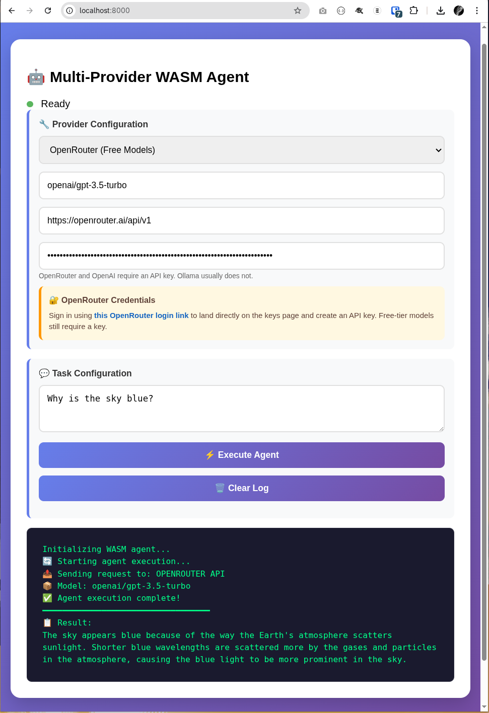

# WASM LLM Agent Demo

[](docs/BUILD_VERIFICATION.md)

A WebAssembly-based LLM agent that runs in the browser and can interact with various LLM providers.

## Features

- 🤖 Runs entirely in the browser using WebAssembly
- 🔄 Supports multiple LLM providers (OpenAI API, Ollama, OpenRouter)
- ⚡ **Real-time Streaming** - Watch the agent think and respond in real-time
- 🛠️ **Advanced Tool Calling** - Built-in environment discovery tools
- ⏹ **Execution Control** - Abort generation at any time
- 📋 **Developer Experience** - One-click code block copying
- 🌐 Universal WASM binary for all platforms

## Architecture & Governance

Architectural decisions, memory safety specifications, and governance records are documented in [docs/adr/](docs/adr/README.md).
- [ADR 0001: WASM Agent Memory Safety, SSE Buffer Handling, and CI Workflow Resilience](docs/adr/0001-wasm-agent-memory-safety-and-ci-workflow-resilience.md)

## Screenshot



## Quick Start

1. **Install prerequisites:**
   ```bash
   # Install Rust
   curl --proto '=https' --tlsv1.2 -sSf https://sh.rustup.rs | sh
   source ~/.cargo/env

   # Add WASM target
   rustup target add wasm32-unknown-unknown

   # Install wasm-pack
   cargo install wasm-pack
   ```

2. **Build and package for distribution:**
   ```bash
   ./build.sh --package
   ```

3. **Open the viewer:**
   ```bash
   # Extract and run the packaged distribution
   unzip wasm-agent-viewer-*.zip
   cd wasm-agent-viewer-* && ./start-server.sh
   # Then open http://localhost:8000 in your browser
   ```

## Distribution

The project includes a complete packaging system for creating downloadable distributions:

### Creating a Distribution Package

```bash
# Build and package
./build.sh --package
```


This creates:
- **`wasm-agent-viewer-YYYYMMDD.zip`** - Cross-platform browser package
- **`wasm-agent-viewer-YYYYMMDD.tar.gz`** - Cross-platform browser package (if `zip` is unavailable, `tar.gz` is produced)

### Distribution Contents

The distribution package includes:
- **Web viewer** - `index.html`
- **WASM package** - `pkg/wasm_agent.js`, `pkg/wasm_agent_bg.wasm`, and `.d.ts` files
- **Server scripts** - `start-server.sh`, `start-server.bat`, `start-server.ps1`

### Running the Distribution

**Web Server Mode (Recommended):**
```bash
unzip wasm-agent-viewer-*.zip
cd wasm-agent-viewer-*
./start-server.sh  # Linux/macOS
# or
start-server.bat   # Windows
```

**Manual Serving:**
```bash
python3 -m http.server 8000
# Then open http://localhost:8000
```

### Testing on Android and iOS Devices (LAN Access)

To test the viewer on a physical Android or iOS device connected to the same Wi-Fi network:

1. **Start the server bound to all interfaces** so your phone can reach it:

   ```bash
   # Linux/macOS (from the extracted distribution folder)
   ./start-server.sh 8000 0.0.0.0

   # Windows PowerShell
   .\start-server.ps1 -Port 8000 -Bind 0.0.0.0

   # Windows cmd
   start-server.bat 8000 0.0.0.0
   ```

   The script will print your machine's LAN IP, for example:
   ```
   LAN access (Android/iOS): http://192.168.1.42:8000
   ```

2. **Open that URL on your device's browser** (Chrome on Android, Safari on iOS).

3. **Requirements on the device:**
   - A modern browser that supports WebAssembly (Chrome 57+, Safari 11+, Firefox 52+).
   - The viewer runs entirely in the browser — no app installation needed.
   - No special headers (COOP/COEP) are required because the WASM module does not use threads or SharedArrayBuffer.

4. **Firewall note:** Ensure port 8000 (or whichever port you chose) is not blocked by your OS firewall.
   - macOS: System Settings → Network → Firewall → allow incoming connections for Python.
   - Windows: Allow Python through Windows Defender Firewall when prompted.

> **iOS Safari note:** iOS Safari 11+ supports WebAssembly. If you see a blank page, check that you are using `http://` and not `file://`, and that JavaScript is enabled in Safari settings.

## Architecture

- `wasm-agent/` - Rust crate compiled to WebAssembly
- `index.html` - Web interface that loads and runs the WASM agent
- `build.sh` - Build script using wasm-pack

## Script Status

- Canonical build script: `build.sh` (use `--package` to create a distribution)
- Deprecated legacy bootstrap scripts: Removed

## Supported Providers

- **OpenAI API**: Compatible with OpenAI, Open WebUI, and similar services
- **Ollama**: Native Ollama API support

## Distribution Options

### Universal Browser Distribution
- **Universal compatibility** - Works in any modern web browser
- **Zero install runtime** - Just extract and serve over HTTP
- **Cross-platform** - Same package works on Windows, macOS, Linux

### Archive Downloads
- **ZIP format** - `wasm-agent-viewer-YYYYMMDD.zip`
- **TAR.GZ format** - `wasm-agent-viewer-YYYYMMDD.tar.gz`
- **Complete packages** - Include all necessary files and documentation

## Development

See [BUILD.md](BUILD.md) for detailed build instructions and architecture notes.

## CI/CD Workflows

The project includes GitHub Actions workflows for automated building and packaging:

### Automated Build & Release Workflow (`build-and-release-viewer.yml`)

**Triggers:**
- Push to `main` branch (builds, tests, and publishes a GitHub release)
- Pull requests to `main` (builds and tests)
- Manual trigger (`workflow_dispatch`) with `release_type` (`beta`, `stable`, `nightly`)

**Features:**
- ✅ Builds WASM module (`./build.sh --package`)
- ✅ Creates complete distribution packages
- ✅ Tests the distribution (server startup, file verification)
- ✅ Creates GitHub releases with downloadable packages
- ✅ Supports on-demand manual builds and nightly releases

### Functional Verification Workflow (`verify.yml`)

**Purpose:**
- Runs the reusable `jsoehner/jsi-build-verify` workflow on pull requests and manual dispatch for end-to-end build and functional verification

### Governance & Compliance Workflows

- `security-governance.yml` — Gitleaks secret scanning, Semgrep SAST, Trivy dependency scanning, and ADR gatekeeper
- `sbom-cbom.yml` — Multi-language SBOM/CBOM and PQC governance (`jsi-bom-actions`)
- `commit-lint.yml` — Conventional Commit enforcement

### Using the Workflows

**Manual Build or Nightly Release:**
1. Go to GitHub Actions → "Build and Release Viewer Packages"
2. Click "Run workflow" and select `release_type` (`beta`, `stable`, or `nightly`)
3. Download the uploaded `viewer-distribution-*` artifact from the workflow run (or from the `nightly` prerelease if `nightly` was selected)

**Creating Releases:**
1. Merge changes to `main` (or use `./release.sh`)
2. The workflow automatically builds, tests, bumps the patch tag, and publishes a GitHub release with downloadable browser package archives

## Build Environment Notes

- `wasm-pack` requires `cargo` to be available in `PATH`.
- If Rust is installed but `cargo` is missing, add:

```bash
export PATH="$HOME/.cargo/bin:$PATH"
```

## Git Ignore

- Root `.gitignore` now ignores generated release archives:
   - `wasm-agent-viewer-*.zip`

## 🤖 Automated Build & Functional Verification

This repository integrates the [`jsoehner/jsi-build-verify`](https://github.com/jsoehner/jsi-build-verify) reusable GitHub Actions workflow ([`.github/workflows/verify.yml`](.github/workflows/verify.yml)) to automatically build and functionally verify the WASM Agent Viewer using an AI coding agent (**Pi Coding Agent**) without maintaining custom per-repo smoke-test scripts.

- **Why it is used:** Traditional CI checks confirm compilation, but `jsi-build-verify` goes further by auto-detecting the Rust/WASM stack, running `wasm-pack` / packaging, starting a local server, and verifying `index.html` in headless Chrome (checking DOM rendering, console errors, and capturing screenshots) while posting a structured verdict and token report on every pull request.
- **How it is configured:** [`.github/workflows/verify.yml`](.github/workflows/verify.yml) invokes `jsoehner/jsi-build-verify` pinned to an immutable commit SHA (`uses:` and `workflow_ref:`) in PR test-harness mode (`commit_mode: report-only`, `fail_on_error: true`, `comment_on_pr: true`), passing only the required least-privilege secrets (`GEMINI_API_KEY` and optional Trusted OSS mTLS credentials).

> [!WARNING]
> **Cost of Operation:** Once you configure an LLM API key secret (`GEMINI_API_KEY` or another supported provider key), **every triggered PR or manual workflow run incurs real LLM API billing**. On this repository, an end-to-end verification run with the default `google` / `gemini-3.1-pro-preview` model consumes ~278k tokens (**~$0.23 per run**). To manage spend, set provider billing limits, switch to a lower-cost model (such as `model: gemini-2.5-flash` with `thinking: low`), or limit triggers to `workflow_dispatch` on high-churn branches.

- **Latest Verification Report:** [`docs/BUILD_VERIFICATION.md`](docs/BUILD_VERIFICATION.md)
- **Learn More:** [jsoehner/jsi-build-verify](https://github.com/jsoehner/jsi-build-verify)

## 🛡️ Security & Cryptographic Posture
This repository integrates the [`jsoehner/jsi-bom-actions`](https://github.com/jsoehner/jsi-bom-actions) GitHub Action ([`.github/workflows/sbom-cbom.yml`](.github/workflows/sbom-cbom.yml)) for automated Software & Cryptographic Bill of Materials (SBOM & CBOM) and Post-Quantum Cryptography (PQC) readiness auditing.

- **Latest Audit Report:** [`docs/security/CRYPTOGRAPHIC_AUDIT.md`](docs/security/CRYPTOGRAPHIC_AUDIT.md)
- **Learn More:** [jsoehner/jsi-bom-actions](https://github.com/jsoehner/jsi-bom-actions)
